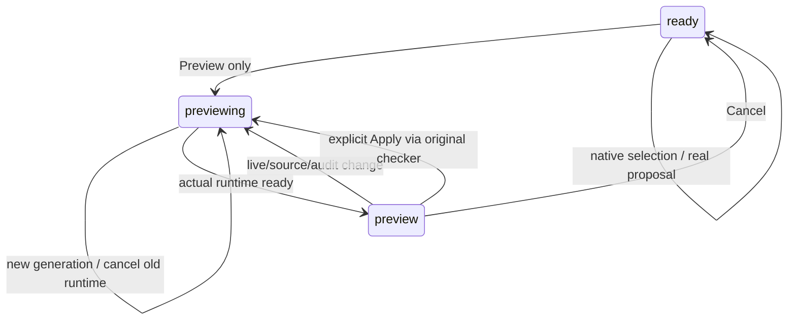

# Experimental panel state table

Original v13 motion/ambient/depth configuration remains byte-exact. No new ambient scene or light.

| State/input | Native appearance/action | Timing | Interrupt/hidden/reduced |
|---|---|---|---|
| Idle | light content panel, transparent view root/clear | no loop | no idle animation |
| Member/row hover | first filled item changes to #e7eefb | immediate 0ms | leave restores base; render restores before diff |
| Click | original proposal or selection callback | immediate; never waits for animation | checker owns rejection; no delayed commit |
| Selected | independent native blue border / explicit USER PREF BEST SELECTED text | immediate | stable keyed IDs; no geometry transform |
| Previewing | host status says recomputing; prior held split retained | asynchronous actual runtime readiness | generation guard, old runtime disposed |
| Preview | native LIVE/PREVIEW split, explicit Apply/Cancel | no loop | real baseline changes recompute; cancel reclaims sessions |
| Invalid/rejected | actual checker reason, dark error text | immediate | source untouched on actual rejection |
| Scroll/zoom | native group scroll / shared layout scale, native hit transforms | input-driven | no independent CSS transform/hit proxy |
| Reduced/hidden | new panels have no motion loops at all | 0ms motion | original panels' existing guards unchanged |

Color parameters live in experiments.js C; layout dimensions in Doc and graphDoc, no duplicated CSS geometry. Actual font wrapping measures native text; no ellipsis. Graph nodes share layout scale with arrows/hits. All additional emitted source blocks ASCII. Numerical text contrast is in payload_contract_report.json; GPU worst-pixel and clipcheck remain manual/unverified.
